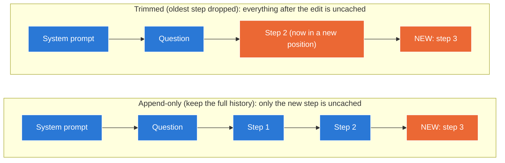
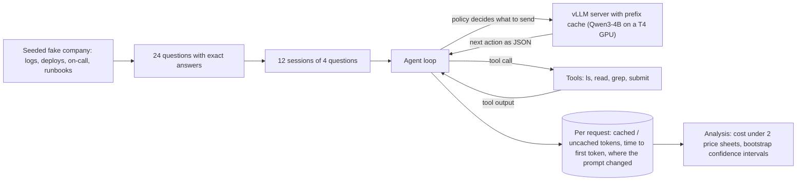
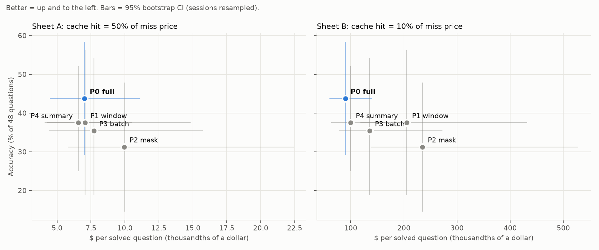
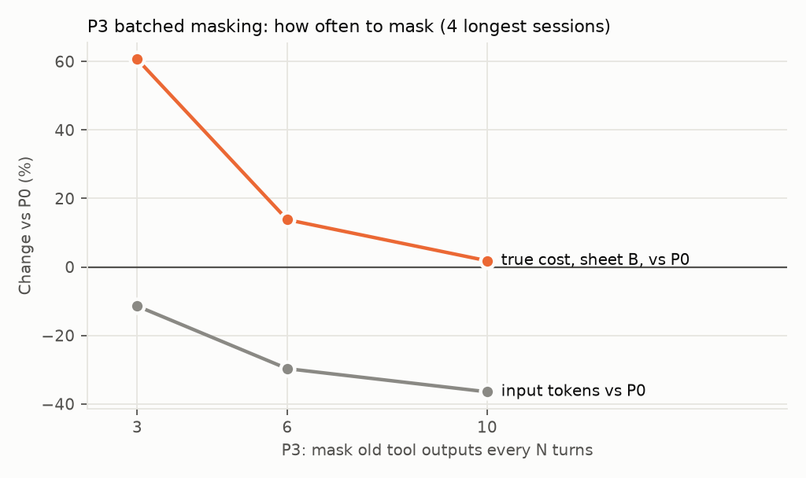
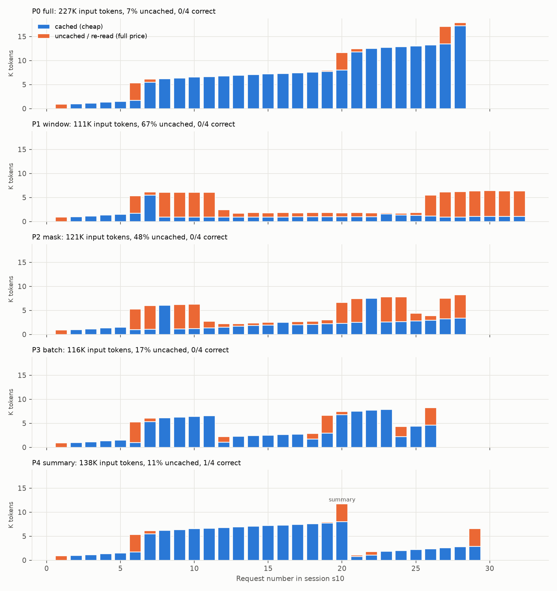

# Keep It Warm

**Every context-trimming policy I tested cut an AI agent's tokens by 22–46%, but under premium
prompt-cache pricing each one cost 1.5–2.6× more per solved question than simply keeping the full
history, because every edit to the prompt broke the prefix cache.**

A reproducible benchmark that measures what context management *really* costs a long-running,
tool-using AI agent once prompt caching is counted. Qwen3-4B on vLLM, free Kaggle T4 GPUs,
exact-answer grading, per-request cache telemetry, 79 tests.

📄 [Paper](paper/keep_it_warm.pdf) · 📝 [Paper (Markdown)](docs/report.md) · 🔬 [Research notes](docs/research_notes.md) · 🧪 [Interactive trace viewer](#) <!-- add the Hugging Face Space link in Phase 8B -->

---

## Contents

1. [The problem, in plain words](#1-the-problem-in-plain-words)
2. [How prompt caching works](#2-how-prompt-caching-works)
3. [What this project measures](#3-what-this-project-measures)
4. [How the experiment works](#4-how-the-experiment-works)
5. [Results](#5-results)
6. [Why the policies also lost accuracy](#6-why-the-policies-also-lost-accuracy)
7. [What this means if you deploy agents](#7-what-this-means-if-you-deploy-agents)
8. [Setup details](#8-setup-details)
9. [Reproduce it](#9-reproduce-it)
10. [Repository layout](#10-repository-layout)
11. [Limitations](#11-limitations)
12. [Glossary](#12-glossary)
13. [References](#13-references)

---

## 1. The problem, in plain words

An **AI agent** is a language model that works step by step: it calls a tool (searches a log, reads a
file), looks at the result, decides the next step, and repeats until it can answer.

Language models have **no memory between steps**. So on every step, the agent sends the model the
*whole story so far*: its instructions, the question, every tool call and every tool output. By step
20, that can be tens of thousands of **tokens** (pieces of words), and you pay for every one of them,
every step.

So teams **trim the history**: drop old steps, blank out old tool outputs, or replace the history with
a summary. Fewer tokens sent should mean a smaller bill.

**The catch:** the servers that run these models have a shortcut called **prompt caching**, and
trimming can break it. When the shortcut breaks, a *shorter* prompt can cost *more* than a longer one.
This project measures how often that happens, and by how much.

> **Analogy.** Imagine a reader who has already read the first 300 pages of a book. Hand them the same
> book with 10 new pages added at the end, and they only read the 10 new pages. Hand them a copy where
> one word on page 3 was changed, and they have to start again from page 3, even though pages 4–300
> are identical. Trimming an agent's history is like editing page 3.

## 2. How prompt caching works

When a server reads a prompt, it computes internal data for every token (the **KV cache**). With
**prefix caching**, it keeps that work. If the next prompt **starts with exactly the same tokens**,
the server reuses it and only processes what's new. Providers pass this saving on: **cached input is
billed at a discount**, typically 2× to 10× cheaper.

The important detail: the server splits the prompt into blocks (16 tokens in vLLM) and fingerprints
each block **together with every block before it**, like links in a chain. One changed token
invalidates its block *and every block after it*.


Blue = reused from the cache (cheap). Orange = processed at full price.

**Measured on this project's setup** (vLLM, Qwen3-4B, a ~5.5K-token prompt):

| Request | Prompt tokens | Cached tokens | Time to first token |
|---|---|---|---|
| 1. Cold (new prefix) | 5,555 | 0 | 14.4 s |
| 2. Same prefix, different question | 5,553 | **5,520 (99.4%)** | **0.23 s** |
| 3. Same prefix with **one character changed** at the start | 5,556 | **0** | 13.4 s |

One changed character threw away the entire cache. The cache also saves **time**: the second request
answered 60× faster.

## 3. What this project measures

**Research question:** for a long-running, tool-using agent, which way of managing its history gives
the best **accuracy per dollar** once cache pricing is counted, and how much depends on *where* and
*how often* the history is edited?

Six **context policies**, each a rule for what to send the model on each turn:

| ID | Policy | What is sent each turn | Where the prompt changes |
|---|---|---|---|
| P0 | **Full history** | Everything, only ever appended to | Never; it only grows |
| P1 | **Sliding window** (6 steps) | Instructions, all questions, and only the last 6 steps | Every turn once the window is full |
| P2 | **Rolling masking** (keep 4) | Everything, but tool outputs older than the last 4 are replaced by a short note | Almost every turn |
| P3 | **Batched masking** (every 6 turns) | The same edit as P2, applied only on every 6th turn | Only on those turns |
| P4 | **Summary** at 8K tokens | When the prompt gets long, the model writes a summary, then continues from instructions + summary + question | Once per summary |
| P5 | **Hygiene bug** | P0, plus `Current time: ...` at the top of the instructions | At the very start, every turn |

Four hypotheses, written down before any experiment ran:

- **H1:** Counting tokens, trimming looks 30–60% cheaper. Counting cache misses, most of that saving
  disappears, and some policies cost *more* than full history.
- **H2:** Making the same edits in batches (P3) recovers most of the saving.
- **H3:** One "harmless" prompt bug (a timestamp) costs more than any policy choice.
- **H4:** Trimming hurts accuracy most on questions whose key clue appeared earlier.

## 4. How the experiment works



**The world ("Incident Desk").** A seeded generator builds a fictional company: 8 microservices, 5 days
of logs, a deploy history, an on-call schedule and runbooks. Clues are planted with distractors, for
example a deploy to a *different* service just before an out-of-memory crash. The same seed produces a
byte-identical world on any machine.

**The questions.** 24 questions in three difficulty tiers, each with one exact answer, for example:
*"Request r-3227 failed. Find the service where the failure originated, the deploy that most recently
preceded it, and who was on call."* Answers are graded by exact matching, with no AI judge. A scripted
"oracle" that uses only the agent's tools solves all 24, which proves every question is answerable.

**Sessions.** Real agents work through many tasks in one conversation, so questions are grouped into
**12 sessions of 4**, and history from earlier questions piles up. Each question appears twice: once
early in a session and once late.

**The agent.** Qwen3-4B on vLLM. It replies with one JSON action per turn using four tools: `ls`,
`read` (up to 60 lines), `grep` (one file) and `submit`. Its instructions were tuned in two pilot runs,
then frozen before the main experiment.

**What's measured on every request.** Prompt tokens, how many were **cached** and how many were
**uncached**, output tokens, time to first token, and the **first token position where the prompt
changed** compared with the previous request. That last one shows exactly where each policy breaks the
cache.

**Cost.** Every request is priced with:

    cost = uncached × miss price + cached × hit price + output × output price

using two price sheets (USD per 1M tokens):

| Sheet | Miss | Hit (cached) | Output | Cache discount |
|---|---|---|---|---|
| **A** (cheap, open-model style) | 0.15 | 0.075 | 0.60 | 2× |
| **B** (premium API style) | 5.00 | 0.50 | 25.00 | 10× |

The main metric is **$ per solved question**: a policy that's cheap but gets everything wrong isn't
cheap.

**Checked before any GPU time was spent.** A fake model with a simulated cache ran every policy on a
laptop, and a test asserts *where* each policy changes the prompt
([`tests/test_prefix_stability.py`](tests/test_prefix_stability.py)).

## 5. Results

### How to read these numbers

- **"vs P0"** compares each policy with keeping the full history. 1.00× means the same cost;
  2.00× means twice as expensive.
- **[95% CI]** is a 95% confidence interval from a bootstrap: the 12 sessions were resampled 2,000
  times to see how much the result could move by chance. If a cost interval doesn't include 1.00×,
  the difference is real, not luck.

### Headline



| Policy | Accuracy [95% CI] | Turns / question | Cached | $ / solved (A) | $ / solved (B) | B vs P0 [95% CI] |
|---|---|---|---|---|---|---|
| **P0 full history** | **44%** [29, 58] | 5.8 | 93% | $0.0070 | **$0.090** | 1.00× |
| P1 sliding window | 38% [19, 56] | 6.1 | 37% | $0.0071 | $0.205 | **2.29×** [1.64, 3.80] |
| P2 rolling masking | 31% [15, 48] | 7.0 | 61% | $0.0100 | $0.235 | **2.62×** [1.83, 5.12] |
| P3 batched masking | 35% [19, 54] | 6.4 | 84% | $0.0077 | $0.136 | **1.51×** [1.06, 2.57] |
| P4 summary (2 runs) | 38% [25, 52] | 6.1 | 91% | $0.0066 | $0.100 | 1.11× [0.95, 1.33] |

12 sessions × 4 questions = 48 questions per policy.

### H1, supported: counting tokens isn't counting money

| Policy | Input tokens | Naive cost (tokens × price) | **True cost, sheet A** | **True cost, sheet B** |
|---|---|---|---|---|
| P1 sliding window | −46% | −42% | −14% | **+96%** |
| P2 rolling masking | −23% | −21% | +1% | **+87%** |
| P3 batched masking | −22% | −19% | −11% | **+22%** |
| P4 summary | −26% | −23% | −20% | −5% |

All changes vs. P0. With a steep cache discount (sheet B), the two policies that edit the prompt
almost every turn nearly **doubled** the bill while sending far fewer tokens. With a mild discount
(sheet A), the savings shrank to almost nothing. **Whether trimming saves money depends on how big
the cache discount is.**

### H2, partly supported: how often you edit matters



Masking old tool outputs every 3 / 6 / 10 turns cost **+61% / +14% / +2%** vs. P0 (sheet B, on the
4 longest sessions). Fewer, larger edits keep more of the cache warm. Batching cut masking's penalty
from 2.62× to 1.51×, but no batched version beat full history under sheet B.

### H3, supported: one timestamp line beats every policy choice

Adding `Current time: ...` to the top of the instructions (P5) dropped the cached share from 94% to
**0%** and made each solved question **6.6× more expensive** (sheet B, 4 sessions), more than any
context policy.

### Where the money goes



One session, five policies, one bar per request. Blue = cached (cheap), orange = processed at full
price. Full history (top) is almost all blue. The sliding window re-processes most of its window on
almost every request. The summary policy pays once, when it summarizes, then stays cheap.

### H4, not supported as stated

Every policy scored below P0 (−6 to −12 points), but **no difference is statistically significant**.
P0 itself lost 12 points on questions 3–4 compared with 1–2, and no policy lost significantly more.

### A finding nobody planned: the noise floor

Running the same policy twice with identical code at temperature 0 changed **6 of 48 answers**. GPUs
don't compute exactly the same sums in exactly the same order every time; when the model is torn
between two next tokens, a tiny difference flips its choice, and the run takes a different path.
Total cost changed by only 2%. So **the cost results are solid, and accuracy gaps of 2–3 questions are
within noise.**

## 6. Why the policies also lost accuracy

From hand-reading the failures:

- **Masking hid results the agent still needed.** After searching 8 services' logs, the agent
  concluded *"inventory has 7, search 2, notifications 3, others have 0"*. The "others" were the
  masked outputs, including the correct answer (orders, 19 errors).
- **Masking caused repeated work:** +1.27 turns per question, re-running searches the agent couldn't
  see it had already tried.
- **Summaries turned beliefs into "facts".** One summary paired the right timestamp with the wrong
  deploy ID; the agent then answered from the summary without checking again.
- About **one third** of masking's lost answers were directly caused by masking. Most of the rest
  looked like the run-to-run noise above.

## 7. What this means if you deploy agents

1. **Count uncached tokens, not tokens.** A context policy only saves money if it lowers *uncached*
   input. With a steep cache discount, an append-only history is a very strong baseline.
2. **If you must edit, edit rarely and late.** Batch edits, fold in large infrequent steps, and keep
   the system prompt and tool list byte-identical across turns.
3. **Audit prompt hygiene first.** A timestamp, request ID or reordered tool list near the top of a
   prompt can cost more than every other optimization combined, and it's a one-line fix.
4. **Summarization is the practical middle ground.** It was the only policy statistically tied with
   full history on cost, and it had the best tail latency (p95 time to first token 6.0 s vs. 10.5 s),
   because its prompts stay short.

**Does this mean never trim?** No. When a history would overflow the model's context window, or the
cache discount is small, trimming can still pay off. The point is to **measure the bill with the cache
counted** before deciding.

## 8. Setup details

| | |
|---|---|
| Model | `Qwen/Qwen3-4B-Instruct-2507`, fp16 |
| Server | vLLM 0.32.0 with `--enable-prefix-caching --enable-prompt-tokens-details --max-model-len 28672`; Triton attention backend (the T4 doesn't support FlashAttention 2) |
| Hardware | Kaggle, 2× Tesla T4, one server per GPU, one request at a time, prefix cache reset before every session |
| Decoding | temperature 0, one seed; P4 run twice to measure noise |
| Statistics | bootstrap over the 12 sessions (2,000 resamples), paired with P0 |
| GPU time | about 3 hours for the main experiment (two GPUs in parallel) |

## 9. Reproduce it

**No GPU needed** for everything except the model runs. The raw results are committed in `runs/main`.

```bash
git clone https://github.com/VatsalRoy/keep-it-warm && cd keep-it-warm
python -m venv .venv && source .venv/bin/activate && pip install -r requirements.txt
make world      # rebuild the world (world_sha256 4a5b9a1a...), 24 questions, 12 sessions
make test       # 79 tests
make fake       # every policy on a fake model with a simulated cache
make analyze    # all tables and charts from the committed runs, into results/
```

**GPU runs:** the notebooks in [`notebooks/`](notebooks) run on a free Kaggle notebook with 2× T4
(about 3 hours) using [`scripts/run_matrix.py`](scripts/run_matrix.py). Runs are resumable: a
crashed session only loses the session in progress.

## 10. Repository layout

```
env/        world generator, tools, questions, sessions, grader, oracle
agent/      agent loop, model clients (vLLM + fake), prompt, pricing
policies/   P0–P5
scripts/    run_episodes, run_matrix, summarize_run, compare_runs, apc_smoke_test
analysis/   analyze.py: bootstrap CIs, charts, failure tags
runs/       raw telemetry (turns.jsonl) and full transcripts (episodes.jsonl)
results/    summary tables and figures
tests/      79 tests, including where each policy changes the prompt
notebooks/  the Kaggle notebooks that produced runs/
paper/      LaTeX source of the IEEE-format paper
docs/       report.pdf, report.md, research_notes.md
```

## 11. Limitations

- One small model (4B), one synthetic world, 48 questions per policy: accuracy differences are
  suggestive, not significant.
- One request at a time per server: how caches behave under many simultaneous users isn't tested.
- Two illustrative price sheets: real providers add rules (minimum cacheable length, cache lifetime)
  not modelled here.
- P4's summary threshold is 8K tokens instead of the planned 16K, because sessions peak at about 11K
  on average. P5 and the cadence sweep ran on 4-session subsets to fit the GPU budget.

## 12. Glossary

| Term | Meaning |
|---|---|
| **Token** | A piece of a word; models read, and providers bill, in tokens |
| **Context / prompt** | Everything sent to the model in one request |
| **KV cache** | The model's internal work for each token of a prompt, which can be stored and reused |
| **Prefix caching** | Reusing that stored work when a new prompt starts with exactly the same tokens |
| **Cache hit / miss** | A token reused from the cache (cheap) or processed from scratch (full price) |
| **Prefill** | The model reading the prompt before it writes anything; this is what caching skips |
| **TTFT** | Time to first token: how long until the answer starts appearing, mostly prefill time |
| **Tool output / observation** | What a tool returned, e.g. the lines a `grep` found |
| **Context policy** | A rule for which parts of the history to send each turn |
| **Session** | One conversation in which the agent answers 4 questions in a row |
| **Price sheet** | The per-token prices used to compute cost (A = mild cache discount, B = steep) |
| **Bootstrap CI** | A range showing how much a result could move by chance, found by resampling the data |

## 13. References

1. Tsinghua NICS-EFC, "Cache Engineering for Agents," arXiv:[2610.28577](https://arxiv.org/abs/2610.28577), 2026 · code: [thu-nics/AKV](https://github.com/thu-nics/AKV)
2. UCSD, "Pack Light, CarryOn," arXiv:[2610.18784](https://arxiv.org/abs/2610.18784), 2026
3. vLLM, [Automatic Prefix Caching](https://docs.vllm.ai/en/stable/features/automatic_prefix_caching/) and [Production Metrics](https://docs.vllm.ai/en/latest/usage/metrics/)
4. W. Kwon et al., "Efficient Memory Management for Large Language Model Serving with PagedAttention," SOSP 2023
5. "The Complexity Trap: Simple Observation Masking Is as Efficient as LLM Summarization," arXiv:[2508.21433](https://arxiv.org/abs/2508.21433), 2025
6. Qwen Team, "Qwen3 Technical Report," arXiv:[2505.09388](https://arxiv.org/abs/2505.09388), 2025

## Citation

```bibtex
@misc{roy2026keepitwarm,
  author = {Vatsal Roy},
  title  = {Keep It Warm: Context Trimming Raises the Cost of Tool-Using LLM Agents Under Prefix-Cache Pricing},
  year   = {2026},
  url    = {https://github.com/VatsalRoy/keep-it-warm}
}
```